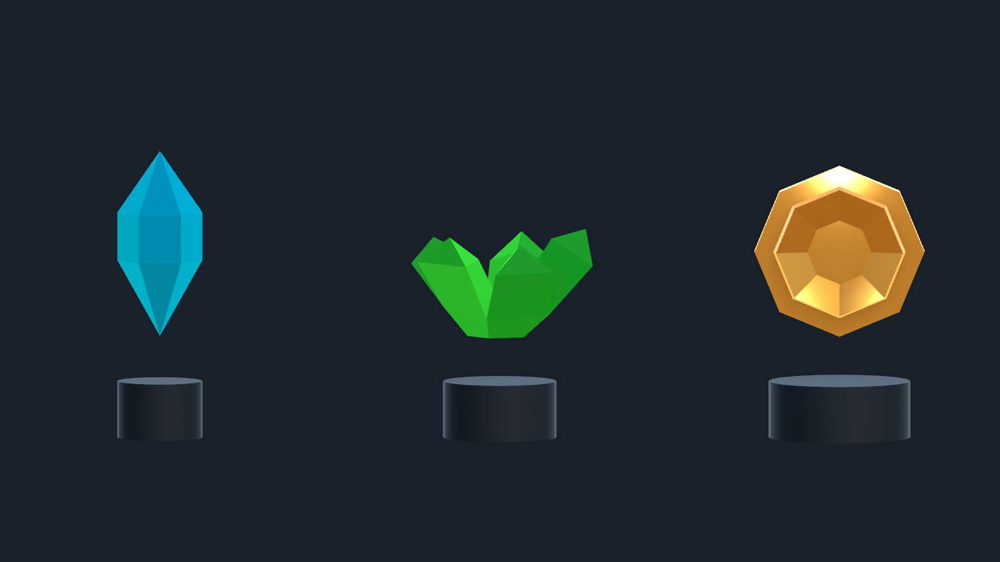
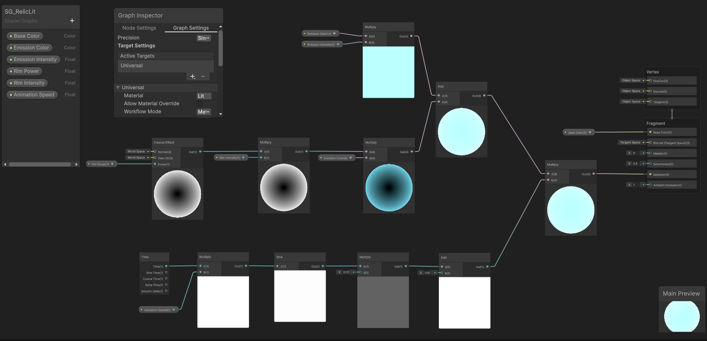
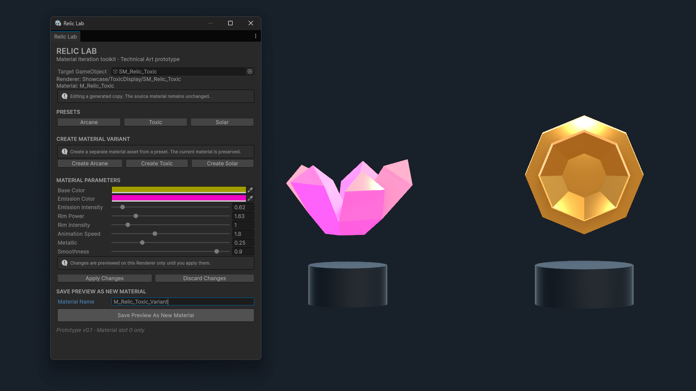
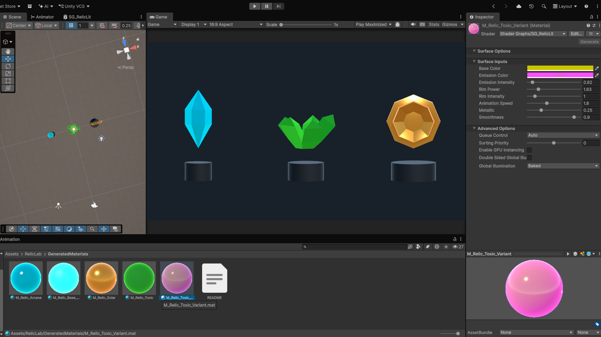

# Relic Lab

**A Unity Editor tool for creating and iterating on stylized relic materials.**

Relic Lab combines a custom **URP Shader Graph** with a **C# EditorWindow** to make material experimentation faster and safer. Artists and developers can explore three visual presets, adjust shader parameters with immediate feedback, and decide whether to apply, discard, or save their work as a separate material asset.

> **Status:** Portfolio prototype — functional material editing workflow and three-relic showcase scene. Screenshots and Video are included below.



_The three stylized relics presented with the shared Relic Lab shader._

## Features

- **Three starting presets:** Arcane, Toxic, and Solar.
- **Live, non-destructive preview:** Adjust properties on the selected Renderer without immediately changing its material asset.
- **Apply / Discard:** Commit previewed values to the current material or revert the preview.
- **Create material variants:** Generate independent material assets from the built-in presets without automatically assigning them to the selected object.
- **Save Preview As New Material:** Save the current preview as a new `.mat` asset while preserving the original material and the object's material assignment.
- **Safe working copies:** Create a generated material copy before editing materials outside the tool's generated-materials folder.
- **Relic showcase:** Preview three distinct stylized relic models in a dedicated scene with pedestals and presentation lighting.

## Tech Stack

- **Unity:** 6.6 (`6000.6.5f1`)
- **Render pipeline:** Universal Render Pipeline (URP)
- **Shader:** Unity Shader Graph (Lit)
- **Editor tooling:** C#, Unity Editor API, UI Toolkit
- **3D modeling:** Autodesk Maya (low-poly FBX assets)

## Getting Started

1. Open the project in **Unity 6.6**.
2. Open `Assets/Scenes/RelicShowcase.unity` to inspect the three modeled relics, or `Assets/Scenes/SampleScene.unity` for the material test scene.
3. Select a GameObject with a Renderer and a material using the Relic Lab shader.
4. In the Unity menu, choose **Tools > Relic Lab > Open Relic Lab**.
5. Assign the GameObject in the **Target GameObject** field if needed. Relic Lab works with **material slot 0**.
6. If prompted, select **Create Safe Working Copy** before editing.
7. Choose a preset or adjust individual parameters. Changes are previewed on the selected object.
8. Use **Apply Changes**, **Discard Changes**, or **Save Preview As New Material** depending on whether you want to update, revert, or preserve a new variation.

Generated material assets are stored in `Assets/RelicLab/GeneratedMaterials/`. The showcase scene uses the same shader and materials as the editing workflow.

## Shader Parameters

| Property           | Purpose                                       |
| ------------------ | --------------------------------------------- |
| Base Color         | Main surface color                            |
| Emission Color     | Color of the emissive effect                  |
| Emission Intensity | Strength of emission                          |
| Rim Power          | Width/falloff of the Fresnel-based rim effect |
| Rim Intensity      | Strength of the rim contribution              |
| Animation Speed    | Speed of the pulsing emission                 |
| Metallic           | Metallic response of the Lit surface          |
| Smoothness         | Surface smoothness and reflection sharpness   |

The shader combines **Lit surface shading**, **Fresnel-based rim emission**, and **time-driven emission pulsing**. Metallic appearance depends on the scene's lighting and reflection environment, not only on the Metallic value.

## Shader Graph Breakdown



_The custom Lit Shader Graph combines a Fresnel-based rim effect with time-driven emission pulsing. Exposed properties let artists adjust color, emission strength, rim response, animation speed, metallic response, and smoothness to create different relic looks._

## Relic Showcase

`Assets/Scenes/RelicShowcase.unity` presents three low-poly relics modeled in **Autodesk Maya**, imported into Unity as FBX assets, and shaded with the shared `SG_RelicLit` Shader Graph.

| Relic      | Model                                    | Material direction                                     |
| ---------- | ---------------------------------------- | ------------------------------------------------------ |
| **Arcane** | Symmetrical, vertically oriented crystal | Cool blue, polished surface, subtle animated emission  |
| **Toxic**  | Irregular five-point crystal cluster     | Green, rough/matte surface, restrained emission        |
| **Solar**  | Octagonal medallion with raised center   | Warm gold, metallic surface, controlled emissive pulse |

The scene includes dark metal pedestals, an orthographic presentation camera, a neutral dark background, and accent lighting. The three assets are intentionally different in silhouette and surface response, demonstrating how a single configurable shader can support multiple art directions.

**Lighting note:** High emission values can overpower the visible metallic response. Solar uses a restrained emissive contribution so its Lit reflections remain readable.

## Editing Workflow

```text
Select an object and material
            |
      Choose a preset
       or edit values
            |
       Live preview
            |
     +------+------+------------------+
     |             |                  |
 Apply Changes  Discard Changes  Save Preview As New Material
     |             |                  |
 Update current  Revert preview  Create independent .mat
 material asset                  (no automatic reassignment)
```



_The EditorWindow provides access to the selected object's material controls and live preview._

### Material Variant Workflow

Preset variants and saved previews serve different purposes: creating a preset variant uses that preset's predefined values; saving a preview captures the values currently being previewed.



_A generated material variant is saved as an independent asset in the generated-materials folder._

## Implementation Notes

- Preview values are applied to the selected Renderer using `MaterialPropertyBlock`, keeping the source `.mat` unchanged until changes are explicitly applied.
- The tool uses the first material slot of the selected Renderer.
- New material assets receive unique paths to avoid overwriting existing variants.
- The project is an **Editor workflow prototype**, not a runtime material-customization system.

## Project Structure

```text
Assets/
├── Materials/                  # Showcase pedestal material
├── Models/                     # Maya-authored relic FBX assets
├── RelicLab/
│   ├── Editor/                 # RelicLabWindow.cs
│   ├── GeneratedMaterials/     # Generated relic .mat assets
│   └── Shaders/               # SG_RelicLit.shadergraph
└── Scenes/
    ├── SampleScene.unity       # Material test scene
    └── RelicShowcase.unity     # Three-relic presentation scene
Docs/
├── Images/
│   ├── relic-showcase.jpg
│   ├── relic-lab-editor.jpg
│   ├── relic-mat-variant-generated.jpg
│   └── relic-shadergraph.jpg
└── Videos/
    └── relic-lab-demo.mp4
```

## Demo Video

A short demonstration of preview, Apply/Discard, and material-variant creation is planned. **Demo video pending.**

## Project Goal

Relic Lab is a portfolio project focused on the intersection of **Technical Art** and **Tools Programming**. Its goal is to demonstrate shader authoring, editor tooling, asset workflow design, and practical usability improvements for material iteration.
